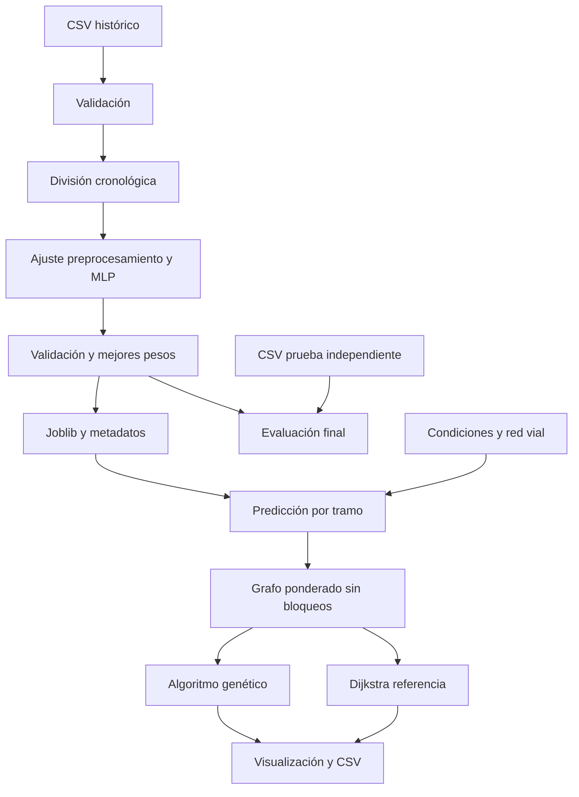

# Arquitectura

La aplicación separa la interfaz de las operaciones de inteligencia artificial. Los archivos CSV contienen datos y características físicas de los corredores simulados. `src/config.py` centraliza rutas y variables. `data_generator.py` genera observaciones; `data_loader.py` valida tipos, rangos, coherencia y separa por tiempo. `preprocessing.py` construye un ColumnTransformer; `neural_network.py` ajusta los transformadores con entrenamiento y entrena las redes por épocas, reteniendo los mejores pesos. `evaluation.py` calcula métricas y referencias simples. `prediction.py` construye entradas desde las condiciones y predice lotes. `traffic_graph.py` crea el grafo dirigido, retirando bloqueos. `genetic_algorithm.py` explora rutas; `visualization.py` genera esquemas y mapas. `utils.py` integra caché y estado de sesión con la interfaz.

Los módulos Streamlit llaman funciones del núcleo sin depender de servicios externos. El dataset se mantiene en la sesión y los modelos se guardan en disco. La huella del dataset impide usar accidentalmente modelos entrenados sobre otra fuente. El esquema Plotly no requiere teselas; la cartografía Folium opcional usa recursos externos. Los pesos se calculan en lote una vez por optimización.
